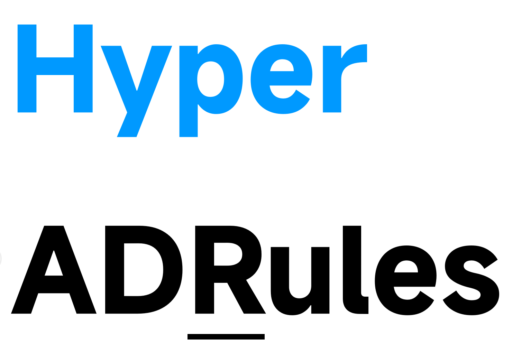

<div align="center">
  
  <h1>HyperADRules</h1>
  <p><strong>下一代广告 / 恶意域名规则聚合</strong><br/>
  多上游合并 · 保守 DNS 语义 · 多客户端一键订阅</p>

  <p>
    <a href="https://github.com/Lynricsy/HyperADRules/actions/workflows/build-release.yml">
      
    </a>
    <a href="https://github.com/Lynricsy/HyperADRules/releases/latest">
      
    </a>
    <a href="https://github.com/Lynricsy/HyperADRules/stargazers">
      
    </a>
    <a href="https://github.com/Lynricsy/HyperADRules/releases">
      
    </a>
  </p>

  <p>
    
    
    
    
    
  </p>

  <p>
    <a href="#快速开始">快速开始</a> ·
    <a href="#按客户端选择格式">格式选择</a> ·
    <a href="#客户端配置">客户端配置</a> ·
    <a href="#产物一览">产物</a> ·
    <a href="#转换策略">转换策略</a> ·
    <a href="#本地构建">本地构建</a>
  </p>
</div>

---

## 这是什么

**HyperADRules** 是广告与恶意域名规则聚合项目：

- 定时拉取多个 DNS 级上游，合并去重
- **保守语义**：路径 / 端口 / 无法表达的 modifier **跳过**，绝不静默扩大为整域误杀
- 一次构建，输出 AdGuard Home、mihomo、Clash、sing-box、Surge、dnsmasq、SmartDNS、Pi-hole 等格式
- 空 `ipcidr` 集合也会发布可加载资产，订阅 URL **不会 404**；mihomo MRS 不支持 0 条 ipcidr，空集 MRS 内含单条
  RFC 6666 discard-only 占位地址 `100::/128`（不会命中真实流量），text / YAML 仍为真正的空集合

### 上游来源

| 上游 | 用途 |
|---|---|
| [GOODBYEADS](https://github.com/8680/GOODBYEADS) `dns.txt` / `allow.txt` | ads / allow 主过滤器 |
| [URLHaus](https://adguardteam.github.io/HostlistsRegistry/assets/filter_11.txt)（AdGuard HostlistsRegistry filter_11） | malware |
| [AdGuard Home For Magisk Mod](https://github.com/liuzq2002/Adguard-Home-For-Magisk-Mod) | `AdGuardHome.yaml` 中的 `user_rules`（ads 补充 + 例外） |
| [anti-AD](https://github.com/privacy-protection-tools/anti-AD) | Clash payload 广告域 + 例外 |
| [dead-horse whitelist](https://raw.githubusercontent.com/privacy-protection-tools/dead-horse/master/anti-ad-white-for-clash.yaml) | 并入 allow |
| [Coolapk 1007 reward](https://raw.githubusercontent.com/lingeringsound/10007/main/reward) | 补充 ads hosts |
| `sources/local_allow.txt` | 仓库本地白名单，覆盖上游误杀业务域 |

---

## 快速开始

先按客户端选择格式，不需要下载整个 Release：

- **AdGuard Home**：使用 `*_adguard.txt`，见下方 [AdGuard Home](#adguard-home)
- **mihomo / Clash Meta**：优先使用 `.mrs`，见下方 [mihomo / Clash Meta](#mihomo--clash-meta)
- **Clash（不支持 MRS）**：使用 `*_clash.yaml`
- **sing-box**：使用 `*_singbox.srs`
- 其他客户端见 [按客户端选择格式](#按客户端选择格式)

规则按用途分为三组：

| `{kind}` | 用途 | 通常动作 |
|---|---|---|
| `ads` | 广告、跟踪域名 | 拦截 |
| `malware` | 恶意、钓鱼域名 | 拦截 |
| `allow` | 误杀例外 | 放行；必须优先于拦截规则 |

所有订阅都使用下面这种**固定地址**：

```text
https://github.com/Lynricsy/HyperADRules/releases/latest/download/<文件名>
```

例如 AdGuard Home 广告规则：

```text
https://github.com/Lynricsy/HyperADRules/releases/latest/download/hyper_adrules_ads_adguard.txt
```

`latest/download` 会自动转到最新 Release。每天发布新版本后地址不变，客户端仍会下载到新内容。不要复制带
`/download/snapshot-YYYYMMDD/` 的版本固定地址，也不需要每次手动更换。

## 按客户端选择格式

下表中的 `{kind}` 替换为 `ads`、`malware` 或 `allow`；订阅地址均为
`https://github.com/Lynricsy/HyperADRules/releases/latest/download/<文件名>`。

| 客户端 / 用途 | 文件名 | 怎么用 |
|---|---|---|
| AdGuard Home | `hyper_adrules_{kind}_adguard.txt` | 在 DNS 封锁清单中添加 `ads`、`malware` URL，在 DNS 允许清单中添加 `allow` URL |
| AdGuard / EasyList 兼容过滤器 | `hyper_adrules_{kind}_easylist.txt` | 作为远程过滤器订阅；内容使用 Adblock DNS 规则语法 |
| mihomo / Clash Meta | `hyper_adrules_{kind}.mrs` | `rule-providers` 设置 `behavior: domain`、`format: mrs` |
| mihomo 的 IP 规则 | `hyper_adrules_{kind}_ipcidr.mrs` | 单独的 provider，设置 `behavior: ipcidr`、`format: mrs` |
| mihomo 文本格式 | `hyper_adrules_{kind}.txt` | provider 设置 `behavior: domain`、`format: text` |
| mihomo 文本 IP 格式 | `hyper_adrules_{kind}_ipcidr.txt` | provider 设置 `behavior: ipcidr`、`format: text` |
| Clash / YAML provider | `hyper_adrules_{kind}_clash.yaml` | provider 设置 `behavior: domain`、`format: yaml` |
| Clash / YAML IP provider | `hyper_adrules_{kind}_clash_ipcidr.yaml` | provider 设置 `behavior: ipcidr`、`format: yaml` |
| sing-box | `hyper_adrules_{kind}_singbox.srs` | 远程 rule-set 设置 `format: binary` |
| sing-box 可读源文件 | `hyper_adrules_{kind}_singbox.json` | 远程 rule-set 设置 `format: source`；通常优先用 SRS |
| Surge Rule Set | `hyper_adrules_{kind}_surge.txt` | 使用 `RULE-SET`，文件内含 `DOMAIN` / `DOMAIN-SUFFIX` / `IP-CIDR` |
| Surge Domain Set | `hyper_adrules_{kind}_surge2.txt` | 使用 `DOMAIN-SET`；只含域名，不含 IP |
| dnsmasq | `hyper_adrules_{ads,malware}_dnsmasq.conf` | 下载后通过 `conf-file=` 引入；只有拦截规则 |
| SmartDNS | `hyper_adrules_{ads,malware}_smartdns.conf` | 下载后通过 `conf-file` 引入；只有拦截规则 |
| Pi-hole / 纯域名列表 | `hyper_adrules_{kind}_domains.txt` | `ads`、`malware` 加入封锁列表；`allow` 加入允许列表 |
| 校验与统计 | `SHA256SUMS` / `manifest.md` / `stats.json` | 校验下载、查看产物统计；不能作为过滤规则导入 |

`_ipcidr` 文件只包含 IP/CIDR 规则，不能当域名列表使用。dnsmasq 和 SmartDNS 没有标准的远程白名单动作，
所以只生成 `ads`、`malware` 文件；`allow` 应使用客户端自己的白名单功能。

## 客户端配置

### AdGuard Home

进入 **过滤器 → DNS 封锁清单 → 添加封锁清单 → 添加自定义列表**，分别添加：

```text
https://github.com/Lynricsy/HyperADRules/releases/latest/download/hyper_adrules_ads_adguard.txt
https://github.com/Lynricsy/HyperADRules/releases/latest/download/hyper_adrules_malware_adguard.txt
```

再进入 **过滤器 → DNS 允许清单 → 添加允许清单 → 添加自定义列表**，添加：

```text
https://github.com/Lynricsy/HyperADRules/releases/latest/download/hyper_adrules_allow_adguard.txt
```

名称可以自行填写，例如 `HyperADRules Ads`、`HyperADRules Malware`、`HyperADRules Allow`。保存后点击
“检查更新”即可立即拉取；之后 AdGuard Home 会按自身过滤器刷新周期继续请求同一个固定 URL。

### mihomo / Clash Meta

MRS 体积更小、加载更快，推荐使用。下面是完整的域名规则配置；如需 IP/CIDR，再按格式表添加对应
`*_ipcidr.mrs` provider，并使用 `no-resolve`。

```yaml
rule-providers:
  hyper_allow:
    type: http
    behavior: domain
    format: mrs
    path: ./ruleset/hyper_adrules_allow.mrs
    url: https://github.com/Lynricsy/HyperADRules/releases/latest/download/hyper_adrules_allow.mrs
    interval: 86400
  hyper_ads:
    type: http
    behavior: domain
    format: mrs
    path: ./ruleset/hyper_adrules_ads.mrs
    url: https://github.com/Lynricsy/HyperADRules/releases/latest/download/hyper_adrules_ads.mrs
    interval: 86400
  hyper_malware:
    type: http
    behavior: domain
    format: mrs
    path: ./ruleset/hyper_adrules_malware.mrs
    url: https://github.com/Lynricsy/HyperADRules/releases/latest/download/hyper_adrules_malware.mrs
    interval: 86400

rules:
  - SUB-RULE,(NETWORK,tcp),hyper_filter
  - SUB-RULE,(NETWORK,udp),hyper_filter
  # 这里继续你的代理 / 直连 / 地区分流
  - MATCH,DIRECT

sub-rules:
  hyper_filter:
    - RULE-SET,hyper_allow,PASS
    - RULE-SET,hyper_ads,REJECT
    - RULE-SET,hyper_malware,REJECT
    - MATCH,PASS
```

白名单必须在拦截规则之前。不要把 allow 写成 `DIRECT`，否则例外域名无法继续匹配后面的代理规则；也不要把
`PASS` 白名单和 `REJECT` 平铺在同一层 `rules` 中。旧版 Clash 不支持 MRS 时，把文件换为
`*_clash.yaml`，并把 `format` 改为 `yaml`。

### sing-box

SRS 是已编译的二进制 rule-set。下面用逻辑规则表达“命中 ads 或 malware，并且没有命中 allow”；
这样白名单只退出本项目的拦截，不会强制改变后续代理路由：

```json
{
  "route": {
    "rules": [
      {
        "type": "logical",
        "mode": "and",
        "rules": [
          { "rule_set": ["hyper-ads", "hyper-malware"] },
          { "rule_set": "hyper-allow", "invert": true }
        ],
        "action": "reject"
      }
    ],
    "rule_set": [
      {
        "tag": "hyper-allow",
        "type": "remote",
        "format": "binary",
        "url": "https://github.com/Lynricsy/HyperADRules/releases/latest/download/hyper_adrules_allow_singbox.srs"
      },
      {
        "tag": "hyper-ads",
        "type": "remote",
        "format": "binary",
        "url": "https://github.com/Lynricsy/HyperADRules/releases/latest/download/hyper_adrules_ads_singbox.srs"
      },
      {
        "tag": "hyper-malware",
        "type": "remote",
        "format": "binary",
        "url": "https://github.com/Lynricsy/HyperADRules/releases/latest/download/hyper_adrules_malware_singbox.srs"
      }
    ]
  }
}
```

如果下载 Release 需要经过代理，可给每个远程规则集增加 `"download_detour": "<出站标签>"`。使用
`*_singbox.json` 时把 `format` 改为 `source`。

### Surge

在 `[Rule]` 中使用远程 Rule Set：

```ini
RULE-SET,https://github.com/Lynricsy/HyperADRules/releases/latest/download/hyper_adrules_ads_surge.txt,REJECT
RULE-SET,https://github.com/Lynricsy/HyperADRules/releases/latest/download/hyper_adrules_malware_surge.txt,REJECT
```

Surge 没有与 mihomo `PASS` 等价的“只跳过当前过滤器”动作。若接受白名单域名固定直连，可把
`hyper_adrules_allow_surge.txt` 作为 `DIRECT` Rule Set 放在上述规则之前；否则不要整表导入 allow，
而应把实际误杀域名加入你现有的优先规则。只需要域名集合时，可把 `RULE-SET` 和 `_surge.txt` 分别换成
`DOMAIN-SET` 和 `_surge2.txt`。

### dnsmasq / SmartDNS

这两种格式需要先下载到本地，再由服务配置文件引入；可用 cron 或 systemd timer 定期覆盖本地文件。

```ini
# dnsmasq
conf-file=/etc/dnsmasq.d/hyper_adrules_ads_dnsmasq.conf
conf-file=/etc/dnsmasq.d/hyper_adrules_malware_dnsmasq.conf

# SmartDNS
conf-file /etc/smartdns/hyper_adrules_ads_smartdns.conf
conf-file /etc/smartdns/hyper_adrules_malware_smartdns.conf
```

下载后重载对应 DNS 服务。此格式只导出明确的域名后缀阻断规则，避免把精确匹配扩大为整个域。

### Pi-hole / 其他纯域名客户端

使用 `*_domains.txt`。它每行一个域名，适合只接受纯域名的客户端；为了不扩大匹配语义，无法安全表达的
“仅子域”和通配符规则不会写入该格式。将 `ads`、`malware` URL 加入封锁列表，将 `allow` URL 加入允许列表。

### 手动下载

只需替换文件名即可下载任何格式：

```bash
base=https://github.com/Lynricsy/HyperADRules/releases/latest/download
curl -fLO "$base/hyper_adrules_ads_adguard.txt"
curl -fLO "$base/SHA256SUMS"
```

---

## 产物一览

GitHub Actions 每天 UTC `20:23` 构建并发布。文件名中 `{kind}` = `ads` / `allow` / `malware`。
完整文件清单、适用客户端和用法见 [按客户端选择格式](#按客户端选择格式)；Release 内的
`manifest.md` 提供当次构建统计。

### Release tag

- 新 tag：`snapshot-YYYYMMDD`（UTC 日期）
- notes 含 `CONTENT_ID`（`SHA256SUMS` 指纹前 16 位）
- 同日重跑：完整且 checksum 一致则跳过；残缺则删重建

---

## 转换策略

只保留 DNS / domain 层能**完整表达**的规则：

| 输入 | 结果 |
|---|---|
| `\|\|example.com^` | `+.example.com` |
| `@@\|\|example.com^` | allow 集合 |
| `\|\|1.2.3.4^` / CIDR | ipcidr |
| hosts `0.0.0.0 ads.example.com` | exact domain |
| `\|\|example.com/path`、`:8443`、query/fragment | **跳过**（不整域扩大） |
| 无法表达的 `$script` 等 modifier | **跳过** |
| 安全 wildcard | 保留为 Clash/mihomo 可编译形式 |

跳过原因会进入 `unsupported_path` / `unsupported_port` / `unsupported_modifier` 统计。

---

## 本地构建

```bash
git clone --depth=1 https://github.com/liuzq2002/Adguard-Home-For-Magisk-Mod upstream-adguard
git clone --depth=1 https://github.com/privacy-protection-tools/anti-AD upstream-anti-ad
curl -fsSL https://raw.githubusercontent.com/8680/GOODBYEADS/master/data/rules/dns.txt -o upstream-goodbyeads-dns.txt
curl -fsSL https://raw.githubusercontent.com/8680/GOODBYEADS/master/data/rules/allow.txt -o upstream-goodbyeads-allow.txt
curl -fsSL https://adguardteam.github.io/HostlistsRegistry/assets/filter_11.txt -o upstream-urlhaus.txt
curl -fsSL https://raw.githubusercontent.com/privacy-protection-tools/dead-horse/master/anti-ad-white-for-clash.yaml \
  -o upstream-anti-ad/anti-ad-white-for-clash.yaml
curl -fsSL https://raw.githubusercontent.com/lingeringsound/10007/main/reward \
  -o upstream-coolapk-1007-reward.txt

uv run python -m scripts.build_rulesets \
  --adguard-source upstream-adguard \
  --goodbyeads-dns-source upstream-goodbyeads-dns.txt \
  --goodbyeads-allow-source upstream-goodbyeads-allow.txt \
  --urlhaus-source upstream-urlhaus.txt \
  --anti-ad-source upstream-anti-ad \
  --coolapk-1007-reward-source upstream-coolapk-1007-reward.txt \
  --local-allow-source sources/local_allow.txt \
  --output dist \
  --adguard-commit "$(git -C upstream-adguard rev-parse HEAD)" \
  --goodbyeads-dns-commit "$(sha256sum upstream-goodbyeads-dns.txt | cut -d ' ' -f 1)" \
  --goodbyeads-allow-commit "$(sha256sum upstream-goodbyeads-allow.txt | cut -d ' ' -f 1)" \
  --urlhaus-commit "$(sha256sum upstream-urlhaus.txt | cut -d ' ' -f 1)" \
  --anti-ad-commit "$(git -C upstream-anti-ad rev-parse HEAD)" \
  --dead-horse-commit "$(sha256sum upstream-anti-ad/anti-ad-white-for-clash.yaml | cut -d ' ' -f 1)" \
  --coolapk-1007-reward-commit "$(sha256sum upstream-coolapk-1007-reward.txt | cut -d ' ' -f 1)"
```

生成二进制：

```bash
mihomo convert-ruleset domain text dist/hyper_adrules_ads.txt dist/hyper_adrules_ads.mrs
# 空 ipcidr 先换成占位地址 100::/128 再 convert-ruleset ipcidr（mihomo 拒绝加载 0 条的 ipcidr MRS）

sing-box rule-set compile --output dist/hyper_adrules_ads_singbox.srs dist/hyper_adrules_ads_singbox.json
```

---

## 反馈

误杀 / 漏拦欢迎开 Issue。规则会定期从上游重建；本仓库只做**保守、可追溯**的格式转换与发布。
